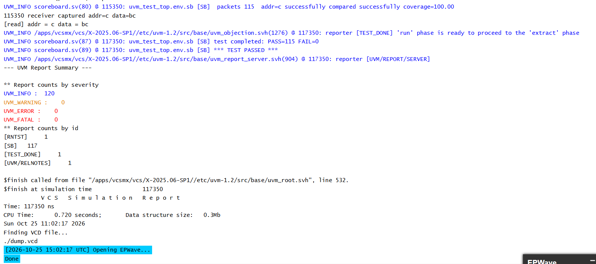
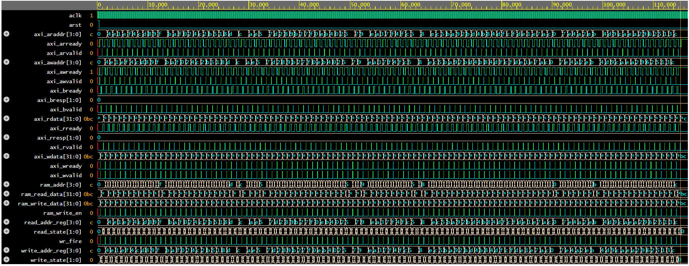

# AXI4 RAM Verification using UVM

A class-based UVM 1.2 testbench that verifies an AXI4-accessible RAM (4-bit address, 32-bit data). The environment drives write and read transactions through the AXI4 channels and checks every read-back value against the data that was written.

## Project Structure

- `rtl/` - `ram_axi_design.sv`, the RAM with its AXI4 interface logic
- `tb/` - everything needed for verification:
  - `interface.sv`, `axi_pkg.sv`, `test_top.sv` - interface, package, and top module
  - `seq_item.sv`, `sequence.sv`, `sequencer.sv` - stimulus generation
  - `driverbase.sv`, `driver.sv` - drives transactions onto the interface
  - `receiverbase.sv`, `receiver.sv` - monitors the bus and collects responses
  - `agent.sv`, `environment.sv`, `test.sv` - agent, environment, and test
  - `scoreboard.sv` - self-checking scoreboard with address coverage
- `images/` - simulation log and waveform screenshots

## How It Works

1. The sequence creates randomized write and read transactions.
2. The driver applies them to the DUT over the AXI4 write and read channels.
3. The receiver samples the bus and sends the observed transactions to the scoreboard.
4. The scoreboard compares the read data with the expected data and tracks which addresses have been covered.

## Running the Simulation

**EDA Playground:** https://edaplayground.com/x/YLgM

- Language: SystemVerilog/Verilog
- Library: UVM 1.2
- Simulator: Synopsys VCS (any UVM-capable simulator also works)
- Top module: `tb_top` (defined in `test_top.sv`), which calls `run_test("axi_test")`

## Simulation Results

- Transactions checked: 115
- Passed: 115, Failed: 0
- Address coverage: 100%
- UVM warnings / errors / fatals: 0 / 0 / 0
- Simulation ended at 117,350 ns

**Console output**

**Waveform**

